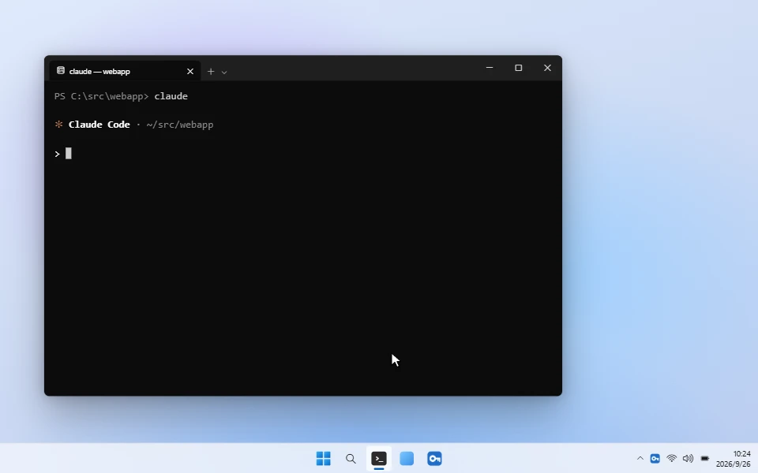
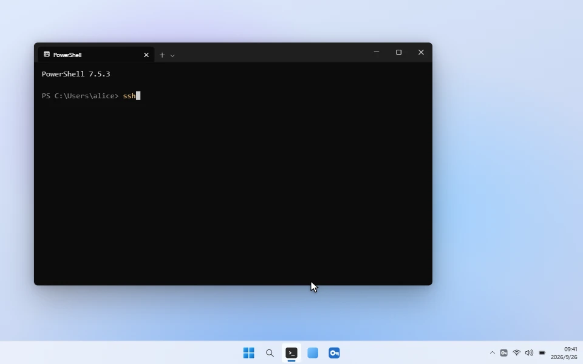
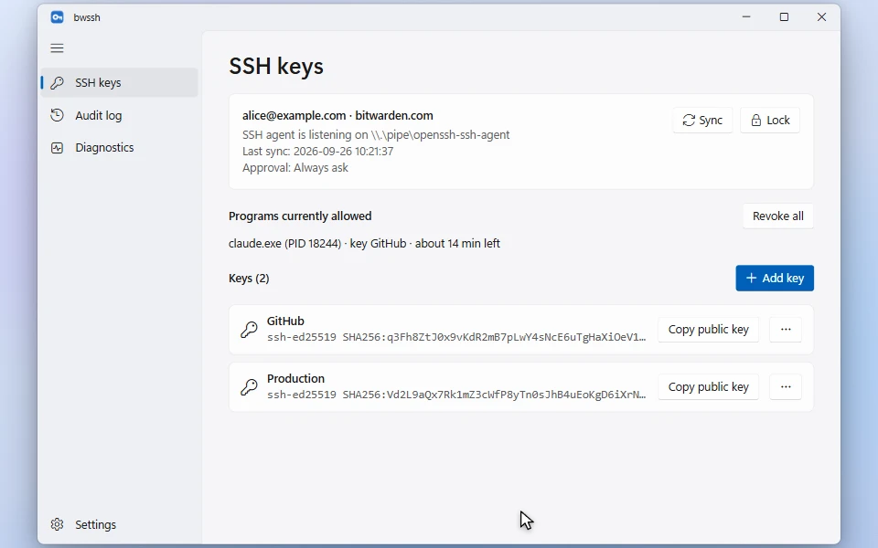
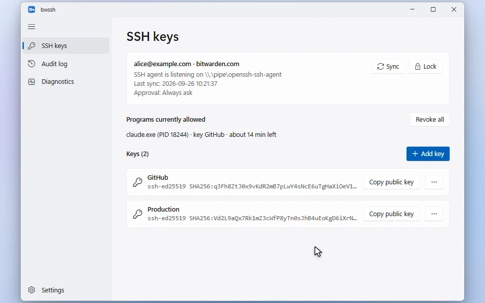

# bwssh

[中文](README.md)

bwssh is a native SSH agent for **Windows and macOS**. It reads SSH keys from your Bitwarden vault and serves them to `ssh`, `git`, and AI agents such as Claude Code.

It works with **official Bitwarden accounts** (bitwarden.com / bitwarden.eu) and with accounts on **self-hosted servers**.

**Promo video** (1:25, with sound; on-screen text in Chinese):

https://github.com/user-attachments/assets/364c4304-048a-4365-b49c-174211e559ef



## Features

- **SSH agent**: works with the system OpenSSH tools (`ssh`, `scp`, `sftp`, `ssh-add`, `ssh-keygen`) and Git SSH commit signing. Supports Ed25519, RSA, and ECDSA (P-256/384/521) keys.
- **System notification approvals**: requests appear in the bottom-right on Windows and the top-right on macOS. They show the process chain, destination host, and key name, with actions to approve or deny.
- **Three approval modes**: always ask; remember each key and host until lock; or never ask while the vault is unlocked.
- **Time-limited approval per program**: choose "Allow 15 min" so the same program, such as your current Claude Code session, can use that key without asking again during that time. The duration is configurable; on macOS you can type the number of minutes directly.
- **Audit log**: records the time, process chain, destination, key, and result of every signing request.
- **Quick unlock**: Windows Hello on Windows, Touch ID on macOS, and PIN on both. When a request arrives while the vault is locked, you can start unlocking and approving it from the notification.
- **Auto-lock and sync**: lock when idle, when the screen locks, or on sleep, and sync the vault on a schedule.
- **Key management**: generate keys (Ed25519 / RSA), import private keys (OpenSSH, PKCS#8, PEM, including passphrase-protected keys), rename them, or move them to the trash.
- **Start at sign-in or on demand**: run in the Windows tray or macOS menu bar, or let `ssh` and `git push` open bwssh when needed (see [Start on demand](#start-on-demand-nothing-resident)).
- **English and Chinese UI**: follows your system language.

## See it in action

The demos below show the Windows version. The macOS version uses native macOS windows and notifications.

### Unlock with Windows Hello from the notification



### Generate, import and manage keys



### Audit log



## Install

### Windows

Download `bwssh-setup-x.y.z.exe` from [Releases](https://github.com/luoxiaoxin123/bwssh/releases) and run it. No administrator rights are needed.

Requirements: Windows 10 2004 (19041) or later, x64. The installer is not code-signed, so SmartScreen may warn on first run. Choose "More info → Run anyway".

### macOS

Requires macOS 13 or later. Apple Silicon and Intel Macs are supported.

1. Open the [macOS downloads page](https://github.com/luoxiaoxin123/bwssh/actions/workflows/macos.yml?query=branch%3Acodex%2Fmacos-native), choose the latest successful build, and download a package from **Artifacts** at the bottom of the page. You need to be signed in to GitHub.

   | Your Mac | Package |
   | --- | --- |
   | M-series chip | `bwssh-macos-arm64` |
   | Intel chip | `bwssh-macos-x86_64` |

2. Extract the download, open the `.dmg` inside, drag `bwssh.app` into Applications, and open it. A `.zip` is also included.
3. Allow notifications when asked, so you can handle approvals in the top-right corner. If notifications were denied earlier, enable them in System Settings → Notifications → bwssh.

The macOS package is not yet notarized by Apple, so macOS may block the first launch. After checking the download source, use "Open Anyway" in System Settings → Privacy & Security. After an update, macOS may ask for Keychain access again.

## Getting started

### Windows

1. Open bwssh and pick a server: bitwarden.com, bitwarden.eu, or a self-hosted server (enter its URL, e.g. `https://vault.example.com`). Then sign in with your email and master password. Two-step login (authenticator app, email, YubiKey OTP) and API key sign-in are supported.
2. Check that your terminal sees the keys:

   ```powershell
   ssh-add -L
   ```

3. If you use Git for Windows, make Git use the built-in Windows OpenSSH. The ssh bundled with Git for Windows cannot use Windows named pipes:

   ```powershell
   git config --global core.sshCommand "C:/Windows/System32/OpenSSH/ssh.exe"
   ```

4. From now on, `ssh`, `git push`, and `git commit -S` trigger an approval notification whenever they need a key.

The Diagnostics page checks the pipe, conflicting programs, and your Git configuration, and includes a one-click connection test.

### macOS

1. Open bwssh, choose bitwarden.com, bitwarden.eu, or your self-hosted server, and sign in with your email and master password. Authenticator, email, and YubiKey OTP two-step login and API key sign-in are supported. API key sign-in also needs the master password to decrypt the vault.
2. Open "Connections" and click "Configure SSH…". If you want SSH to launch bwssh automatically, choose "Set up…" under "On-demand launch" instead; that includes the SSH configuration.
3. Run the following in your terminal, then add the first line to `~/.zshrc` so new terminals use it too. For other shells, use the corresponding startup file.

   ```sh
   export SSH_AUTH_SOCK="$HOME/Library/Application Support/bwssh/agent.sock"
   ssh-add -L
   ```

4. Once your public keys appear, use `ssh`, `git push`, and other SSH commands normally. Key requests appear as notifications in the top-right corner. Actions may be inside the notification's Options menu; click the notification to see full details.

macOS uses its built-in SSH client. You don't need another SSH program or to disable the system ssh-agent. If notifications are disabled, bwssh uses a small approval window instead.

### Signing Git commits

Both versions support SSH commit signing. Copy the **public key** from bwssh, then configure Git:

```sh
git config --global gpg.format ssh
git config --global user.signingkey 'ssh-ed25519 AAAA...'
git config --global commit.gpgsign true
```

Replace `ssh-ed25519 AAAA...` with your full public key. On macOS, also set `SSH_AUTH_SOCK` as shown above. Open bwssh before signing: `git commit -S` does not launch it automatically.

## Master password, Touch ID, and PIN

bwssh starts with the vault locked after each restart. Unlock with the master password or a previously configured Windows Hello on Windows, or the master password or Touch ID on macOS.

To enable Touch ID, first unlock with your master password, then open Settings → Quick unlock → Set up Touch ID. Macs without Touch ID can use the master password and PIN.

By default, PIN requires one master password or Windows Hello / Touch ID unlock after each start. To use PIN immediately after restarting:

- **Windows**: when setting up the PIN, uncheck "After restarting, require the master password or Windows Hello first".
- **macOS**: turn off "Require master password or Touch ID after each launch" in Settings → Quick unlock. You do not need to set up an existing PIN again.

Unlock the vault before changing these settings. Five incorrect PIN attempts remove the PIN; use the master password or your configured Windows Hello / Touch ID to unlock. Restarting does not give you more PIN attempts.

## Using it with Claude Code and other agents

When an agent runs `git push`, `ssh`, and similar commands, you get the same approval notification. It shows which agent started the request, for example `claude.exe → bash.exe → git.exe → ssh.exe`.

- To let an agent run several git operations in a row, choose "Allow 15 min". That agent process can then use the key without asking. A different agent process, a different key, or locking the vault asks again.
- Allowed programs are listed on the SSH keys page, where you can revoke them at any time. You can also revoke all temporary approvals from the Windows tray or macOS menu bar menu.
- Every request is written to the audit log.

## Start on demand (nothing resident)

### Windows

Don't want bwssh to start with Windows, or to open it by hand first? On the Diagnostics page, under "Start on demand", click "Set up". From then on, when `ssh` or `git push` runs and bwssh isn't running, bwssh starts in the tray and the connection continues. No background process or service stays resident in the meantime.

"Set up" does two things:

- It adds a `Match exec` rule at the top of `~/.ssh/config`. Before every connection, ssh runs `bwssh.exe --ensure-agent`, which returns immediately if bwssh is running. Otherwise it starts bwssh and returns once the agent is ready. The previous file is backed up to `config.bwssh.bak`.
- It puts `ssh`, `scp`, `sftp`, and `ssh-add` scripts in `~/bin`. By default, Git Bash uses the ssh bundled with Git, which cannot reach Windows named pipes. These scripts make Git Bash use the Windows OpenSSH client instead. Only Git Bash puts `~/bin` on its PATH, so cmd and PowerShell are not affected. Existing files with the same names are left alone.

| Where `ssh` runs | Supported |
|---|---|
| cmd, PowerShell | ✅ |
| Git Bash (including the Claude Code Bash tool) | ✅ |
| `git push` / `git pull` in any terminal | ✅ (with `core.sshCommand` set as in step 3 of Getting started) |

- **Latency**: about 0.5 s extra when bwssh has to start, and about 0.1–0.2 s per connection when it is already running.
- **Memory**: the check process lives for about 0.1 s and uses about 9 MB of private memory, all of which is freed when it exits.
- **Undo**: click "Undo" on the same card. Uninstalling bwssh also cleans this up.

### macOS

Move bwssh into Applications first. In Connections → On-demand launch, click "Set up…". When `ssh`, `scp`, `sftp`, or Git push/pull over SSH needs bwssh, it starts in the menu bar before the connection continues.

Setup updates `~/.ssh/config` to use bwssh and check whether it is running before a connection. The original is backed up to `~/.ssh/config.bwssh.bak`; an existing backup is preserved. Run setup again if you move the app.

To undo, click "Remove bwssh SSH configuration…". This removes only bwssh's additions and keeps your other SSH settings. You can also do this before deleting the app.

### On both platforms

- `ssh-add` and Git SSH commit signing do not read SSH configuration and cannot start bwssh automatically. Open the app first.
- On-demand launch only opens the app. A locked vault still needs unlocking, and key requests follow your approval settings.
- Closing the main window leaves bwssh running in the tray or menu bar. Choose Quit from that menu to exit completely; the next SSH connection can start it again.
- Git push/pull must use an SSH remote URL. HTTPS remotes do not use the SSH agent.

## Notes

- **Windows pipe conflicts**: only one program can own `\\.\pipe\openssh-ssh-agent` at a time.
  - If the Windows OpenSSH Authentication Agent service is running, run this in an elevated PowerShell:

    ```powershell
    Stop-Service ssh-agent; Set-Service ssh-agent -StartupType Disabled
    ```

  - If the Bitwarden desktop app has its SSH agent turned on, turn it off in that app's settings.
  - Once the pipe is free, bwssh takes it over within 5 seconds.
- **macOS uses the wrong agent**: configure SSH in Connections, then check that your terminal has `SSH_AUTH_SOCK` set as shown above. Existing terminals and IDEs need the updated environment; restart them if necessary.
- **Not supported**: SSO sign-in; Duo and WebAuthn two-step login; accounts that use the new COSE encryption format; PuTTY `.ppk` keys (export them to OpenSSH format with PuTTYgen first).

## Data and security

- **Windows**: local data lives in `%LOCALAPPDATA%\BwSshAgent`. Synced vault data stays encrypted. Windows DPAPI additionally protects it, tokens, the public key list, and PIN settings for the current Windows user.
- **macOS**: local data lives in `~/Library/Application Support/bwssh`. The vault stays encrypted, and local data has an additional encryption layer whose key is kept in the current user's Keychain.
- The master password is not saved locally. Private keys are decrypted for signing only while the vault is unlocked and cleared from memory on lock.
- Vault writes (create, rename, move to trash) are encrypted locally before upload. The server only receives ciphertext.
- PIN protects the user key with an Argon2id-derived key. You can choose whether it works immediately after restart. Five incorrect attempts remove the PIN.
- Windows Hello uses system-protected credentials. Touch ID uses a Keychain item that requires fingerprint authentication.
- Local SSH agent connections are restricted to the current user.

## Building from source

### Windows

Requires the .NET 10 SDK. Building the installer also requires [Inno Setup 6](https://jrsoftware.org/isinfo.php).

```powershell
dotnet test --project tests/BwSshAgent.Core.Tests   # run the tests
./build.ps1 -Version 1.0.0                           # writes artifacts/installer/bwssh-setup-1.0.0.exe
```

The demo animations in this README come from [docs/demo](docs/demo): `stage.html` recreates the UI in HTML and drives it along a timeline, and `render.py` captures it frame by frame in Edge and encodes them as 60 fps animated WebP. After changing `stage.html`, run `python docs/demo/render.py` to regenerate them (requires `pip install playwright pillow numpy`).

For Windows, when you publish a new GitHub Release, the [workflow](.github/workflows/release.yml) runs the tests, builds the installer, and attaches it to that release.

### macOS

Requires Swift and Xcode. Test and package for your Mac's architecture:

```sh
swift test --package-path macos
python3 macos/package.py --arch arm64 --version 1.0.4
# On Intel Macs, replace arm64 with x86_64.
```

Packages are written to `artifacts/macos/<arch>/`. The [macOS workflow](.github/workflows/macos.yml) tests and builds separate ARM and Intel packages. See the [macOS development notes](macos/README.md) for more build and debugging details.

## License

[Apache License 2.0](LICENSE)
