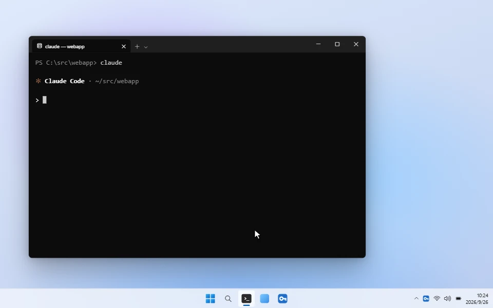
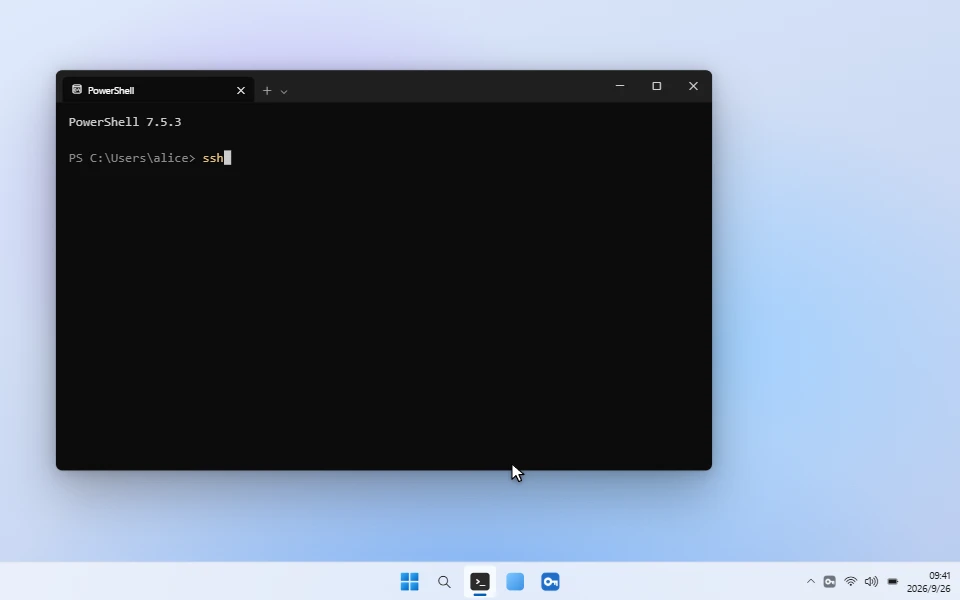
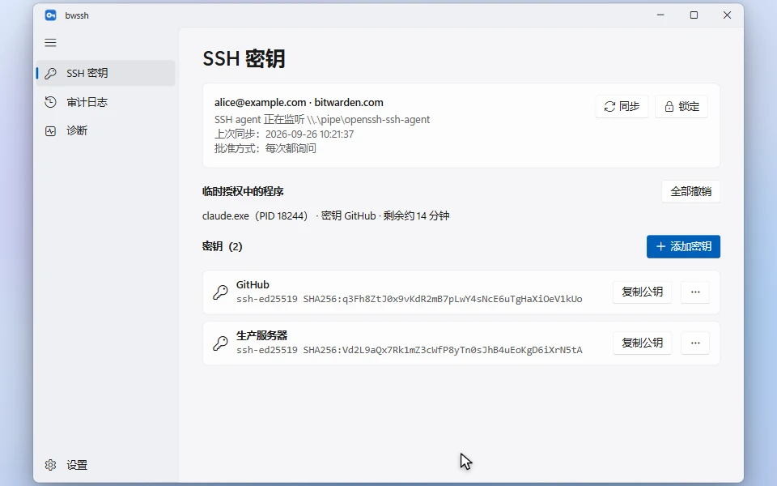
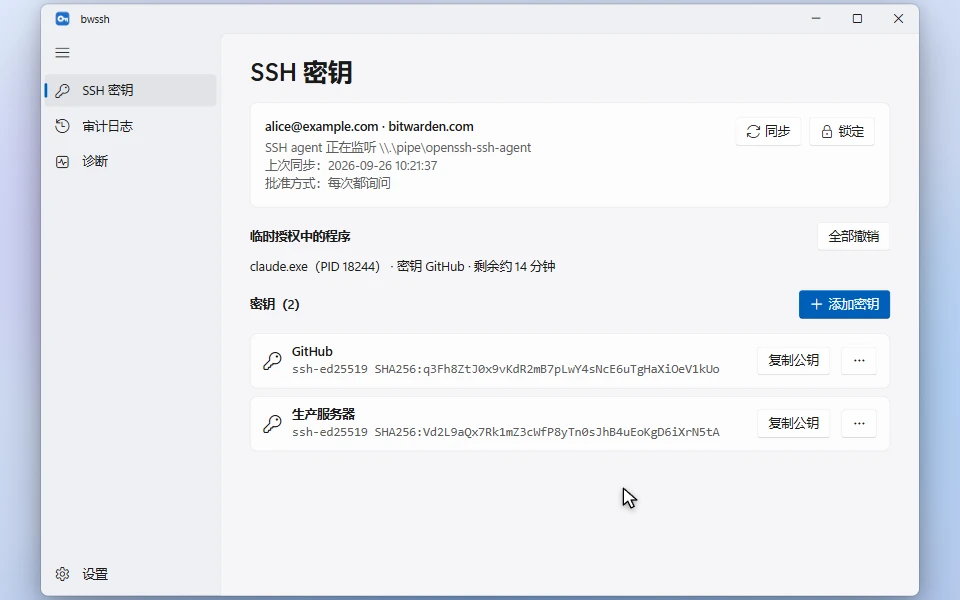

# bwssh

[English](README.en.md)

bwssh 是一个支持 **Windows 和 macOS** 的原生 SSH agent。它从 Bitwarden 密码库读取 SSH 密钥，给 `ssh`、`git` 以及 Claude Code 这类 AI Agent 使用。

支持 **Bitwarden 官方账号**（bitwarden.com / bitwarden.eu），也支持**自建服务器**上的账号。

**宣传片**（1 分 25 秒，有声音）：

https://github.com/user-attachments/assets/364c4304-048a-4365-b49c-174211e559ef



## 功能

- **SSH agent**：支持系统自带的 OpenSSH（`ssh`、`scp`、`sftp`、`ssh-add`、`ssh-keygen`），以及 Git 的 SSH 提交签名。支持 Ed25519、RSA、ECDSA（P-256/384/521）密钥。
- **系统通知审批**：程序使用密钥时，Windows 在右下角、macOS 在右上角弹出通知，显示发起的程序链、目标主机和密钥名称，可以直接批准或拒绝。
- **三种批准方式**：每次都询问；锁定密码库前记住同一把密钥、同一台主机；从不询问（解锁状态下直接放行）。
- **按程序限时放行**：通知上点“15 分钟内放行”后，这个程序（比如当前这个 Claude Code 会话）在 15 分钟内使用这把密钥都不再询问。时长可以调整，macOS 版支持直接输入分钟数。
- **审计日志**：记录每次签名的时间、程序链、目标主机、密钥和结果。
- **快速解锁**：Windows 支持 Windows Hello，macOS 支持 Touch ID，两端都支持 PIN。锁定状态下收到请求时，可以从通知发起解锁并批准。
- **自动锁定与同步**：可以在空闲、锁屏、睡眠时自动锁定，并定时同步密码库。
- **管理密钥**：可以生成新密钥（Ed25519 / RSA），导入已有私钥（OpenSSH、PKCS#8、PEM，支持带密码的私钥），也可以改名或移到回收站。
- **开机自启或按需启动**：Windows 常驻托盘，macOS 常驻菜单栏；也可以不自启，执行 `ssh`、`git push` 时自动打开 bwssh（见[按需启动](#按需启动不需要常驻后台)）。
- **中英文界面**：自动跟随系统语言。

## 演示

以下动图展示的是 Windows 版，macOS 版使用原生界面和系统通知。

### 锁定时直接用 Windows Hello 解锁



### 生成、导入和管理密钥



### 审计日志



## 安装

### Windows

在 [Releases](https://github.com/luoxiaoxin123/bwssh/releases) 页面下载 `bwssh-setup-x.y.z.exe` 并运行。安装不需要管理员权限。

系统要求：Windows 10 2004（19041）或更高版本，x64。安装包没有代码签名，首次运行时 SmartScreen 可能会提示，点“更多信息 → 仍要运行”即可。

### macOS

系统要求：macOS 13 或更高版本，支持 Apple Silicon 和 Intel。

1. 打开 [macOS 下载页](https://github.com/luoxiaoxin123/bwssh/actions/workflows/macos.yml?query=branch%3Acodex%2Fmacos-native)，选择最近一次成功的构建，在页面底部的 **Artifacts** 下载对应的包（需要登录 GitHub）：

   | 你的 Mac | 下载哪个包 |
   | --- | --- |
   | M 系列芯片 | `bwssh-macos-arm64` |
   | Intel 芯片 | `bwssh-macos-x86_64` |

2. 解压下载的文件，打开里面的 `.dmg`，把 `bwssh.app` 拖到“应用程序”文件夹，再打开它。也可以使用包内的 `.zip`。
3. 首次运行时允许 bwssh 发送通知，之后才能在右上角直接处理密钥审批。如果之前没允许，可以到“系统设置 → 通知 → bwssh”中开启。

当前 macOS 包尚未通过 Apple 公证，首次打开可能被系统拦截。确认下载来源后，可到“系统设置 → 隐私与安全性”中选择“仍要打开”。更新后，系统也可能再次询问是否允许访问钥匙串。

## 快速开始

### Windows

1. 打开 bwssh，选择服务器：bitwarden.com、bitwarden.eu 或自托管服务器（填入地址，例如 `https://vault.example.com`），然后用邮箱和主密码登录。也支持两步验证（验证器 App、邮件、YubiKey OTP）和 API Key 登录。
2. 确认终端能看到密钥：

   ```powershell
   ssh-add -L
   ```

3. 如果用 Git for Windows，让 Git 使用系统自带的 OpenSSH。Git for Windows 自带的 ssh 不支持 Windows 命名管道：

   ```powershell
   git config --global core.sshCommand "C:/Windows/System32/OpenSSH/ssh.exe"
   ```

4. 之后 `ssh`、`git push`、`git commit -S` 用到密钥时，右下角会弹出审批通知。

程序的“诊断”页可以检查管道状态、冲突程序和 Git 配置，还能一键测试。

### macOS

1. 打开 bwssh，选择 bitwarden.com、bitwarden.eu 或自建服务器，用邮箱和主密码登录。支持验证器、邮件、YubiKey OTP 两步验证，以及 API Key 登录；API Key 登录也需要主密码来解密密码库。
2. 打开“连接与诊断”，点击“配置 SSH…”。如果希望执行 SSH 时自动启动 bwssh，直接在下方“按需启动”里点“设置…”即可，不用重复配置。
3. 在终端执行下面的命令，再把第一行加入 `~/.zshrc`，方便新开的终端继续使用。如果使用其他 shell，请加入对应的配置文件。

   ```sh
   export SSH_AUTH_SOCK="$HOME/Library/Application Support/bwssh/agent.sock"
   ssh-add -L
   ```

4. 看到自己的公钥后，就可以正常执行 `ssh`、`git push` 等命令。需要使用密钥时，右上角会弹出审批通知；操作可能收在通知的“选项”菜单里。点击通知可以查看完整详情。

macOS 直接使用系统自带的 SSH，不需要安装其他 SSH 程序，也不需要关闭系统的 ssh-agent。如果通知被禁用，bwssh 会显示一个小窗口供你审批。

### 用 Git 签名提交

两端都支持 SSH 提交签名。在 bwssh 中复制要使用的**公钥**，然后配置 Git：

```sh
git config --global gpg.format ssh
git config --global user.signingkey 'ssh-ed25519 AAAA...'
git config --global commit.gpgsign true
```

把示例中的 `ssh-ed25519 AAAA...` 换成自己的完整公钥。macOS 还需要设置上面的 `SSH_AUTH_SOCK`。签名前请先打开 bwssh；`git commit -S` 不会按需启动应用。

## 主密码、Touch ID 和 PIN

每次重新启动 bwssh，密码库都会先保持锁定。Windows 可以用主密码或已设置的 Windows Hello 解锁，macOS 可以用主密码或已设置的 Touch ID 解锁。

macOS 用户先用主密码解锁一次，再到“设置 → 快速解锁”点击“设置 Touch ID…”。没有可用 Touch ID 的 Mac 也可以使用主密码和 PIN。

PIN 默认要求每次启动后先用主密码或 Windows Hello / Touch ID 解锁一次，之后才能使用。如果希望重启后直接用 PIN：

- **Windows**：设置 PIN 时，取消勾选“重启程序后需要先用主密码或 Windows Hello 解锁”。
- **macOS**：在“设置 → 快速解锁”关闭“每次启动后先用主密码或 Touch ID 解锁”。已有 PIN 不需要重新设置。

修改解锁设置前需要先解锁密码库。PIN 连续输错 5 次会被清除，需要用主密码或已设置的 Windows Hello / Touch ID 解锁；重启程序不会清除错误次数。

## 在 Claude Code 等 Agent 中使用

Agent 执行 `git push`、`ssh` 等命令时，同样会触发审批通知。通知里会显示是哪个 Agent 发起的请求，比如 Windows 上的 `claude.exe → bash.exe → git.exe → ssh.exe`，或 macOS 上的 `Claude → git → ssh`。

- 让 Agent 连续执行几次 git 操作：点“15 分钟内放行”，这段时间内同一个 Agent 进程使用这把密钥时不再询问。换一个 Agent 进程、换一把密钥，或者锁定密码库之后，都会重新询问。
- 已授权的程序会显示在“SSH 密钥”页，可以随时撤销。Windows 托盘菜单和 macOS 菜单栏菜单里也可以撤销所有临时授权。
- 所有请求都会记入“审计日志”。

## 按需启动（不需要常驻后台）

### Windows

不想开机自启，也不想每次先手动打开 bwssh？在“诊断”页的“按需启动”里点“一键设置”。之后执行 `ssh`、`git push` 时，如果 bwssh 没有运行，会先在托盘中把它启动起来，再继续连接。平时没有任何常驻的后台进程或服务。

一键设置会做两件事：

- 在 `~/.ssh/config` 开头加入一段 `Match exec` 规则。ssh 每次连接前都会执行 `bwssh.exe --ensure-agent`：bwssh 已在运行就立即返回，没有运行就启动它，等 agent 就绪后再返回。修改前会把原文件备份为 `config.bwssh.bak`。
- 在 `~/bin` 中放入 `ssh`、`scp`、`sftp`、`ssh-add` 四个转发脚本。Git Bash 默认用的是 Git 自带的 ssh，它连不上 Windows 命名管道；有了这些脚本，Git Bash 会改用系统 OpenSSH。`~/bin` 只有 Git Bash 会加入 PATH，不影响 cmd 和 PowerShell。已有同名文件的不会覆盖。

| 在哪里执行 `ssh` | 是否支持 |
|---|---|
| cmd、PowerShell | ✅ |
| Git Bash（包括 Claude Code 的 Bash 工具） | ✅ |
| 任意终端里的 `git push` / `git pull` | ✅（需要按“快速开始”第 3 步设置 `core.sshCommand`） |

- **耗时**：bwssh 没有运行时，这次连接多等约 0.5 秒；已在运行时，每次连接多约 0.1～0.2 秒。
- **内存**：检查进程只存在约 0.1 秒，独占内存约 9 MB，结束后全部释放。
- **撤销**：在同一张卡片上点“撤销”即可。卸载 bwssh 时也会自动清理。

### macOS

先把 bwssh 放进“应用程序”文件夹，在“连接与诊断 → 按需启动”里点“设置…”。之后执行 `ssh`、`scp`、`sftp`，或通过 SSH 执行 `git push` / `git pull` 时，如果 bwssh 没有运行，会先把它启动到菜单栏，再继续连接。

设置会修改 `~/.ssh/config`，让 SSH 使用 bwssh，并在连接前检查它是否运行。原文件会备份为 `~/.ssh/config.bwssh.bak`，已有备份不会被覆盖。移动应用位置后，请重新设置。

不需要这项配置时，点击“移除 bwssh 的 SSH 配置…”。它只会删除 bwssh 添加的部分，保留其他 SSH 配置；删除应用前也可以先这样清理。

### 两端都要注意

- `ssh-add` 和 Git 的 SSH 提交签名不读取 SSH 配置，不会自动启动 bwssh，使用前请先打开应用。
- 按需启动只负责打开应用。密码库锁定时仍需解锁，使用密钥仍按你的审批设置处理。
- 关闭主窗口后，bwssh 仍在托盘或菜单栏运行。想完全退出，请在托盘或菜单栏菜单里选择“退出”；下次 SSH 连接时会再次自动启动。
- `git push` / `git pull` 需要使用 SSH 远程地址；HTTPS 地址不会用到 SSH agent。

## 注意事项

- **Windows 管道冲突**：`\\.\pipe\openssh-ssh-agent` 同时只能被一个程序占用。
  - 如果 Windows 的 OpenSSH Authentication Agent 服务在运行，以管理员身份执行：

    ```powershell
    Stop-Service ssh-agent; Set-Service ssh-agent -StartupType Disabled
    ```

  - 如果 Bitwarden 桌面客户端开启了 SSH agent，请在它的设置中关闭。
  - 占用解除后，bwssh 会在 5 秒内自动接管。
- **macOS 连接到了其他 agent**：先在“连接与诊断”配置 SSH，再检查终端是否设置了上面的 `SSH_AUTH_SOCK`。已有终端或 IDE 需要重新加载环境变量，必要时重启它们。
- **不支持**：SSO 登录；Duo、WebAuthn 两步验证；使用新版 COSE 加密格式的账户；PuTTY `.ppk` 私钥（请先用 PuTTYgen 导出为 OpenSSH 格式）。

## 数据与安全

- **Windows**：本地数据保存在 `%LOCALAPPDATA%\BwSshAgent`。同步下来的密码库保持加密，登录令牌、公钥列表和 PIN 设置也会额外使用 Windows DPAPI 保护，只有当前 Windows 用户能读取。
- **macOS**：本地数据保存在 `~/Library/Application Support/bwssh`。密码库保持加密，本地数据还会额外加密，所需密钥保存在当前用户的钥匙串中。
- 主密码不会保存到本地。私钥只在解锁状态下解密并用于签名，锁定后清除内存中的密钥。
- 对密码库的写入（新建、改名、移到回收站）上传前全部在本地加密，服务器只收到密文。
- PIN 使用 Argon2id 派生的密钥保护用户密钥。是否允许重启后直接使用 PIN，可以在设置时选择；连续输错 5 次会清除 PIN。
- Windows Hello 使用系统保护的凭据；Touch ID 使用需要指纹验证才能读取的钥匙串项目。
- SSH agent 的本地连接只允许当前用户访问。

## 从源码构建

### Windows

需要 .NET 10 SDK。打包安装程序还需要 [Inno Setup 6](https://jrsoftware.org/isinfo.php)。

```powershell
dotnet test --project tests/BwSshAgent.Core.Tests   # 运行测试
./build.ps1 -Version 1.0.0                           # 输出 artifacts/installer/bwssh-setup-1.0.0.exe
```

README 里的演示动图由 [docs/demo](docs/demo) 生成：`stage.html` 用 HTML 复刻界面并按时间轴驱动画面，`render.py` 用 Edge 逐帧截图并编码成 60 fps 动态 WebP。修改 `stage.html` 后执行 `python docs/demo/render.py` 即可重新生成（需要 `pip install playwright pillow numpy`）。

Windows 版在 GitHub 上发布新的 Release 时，[workflow](.github/workflows/release.yml) 会自动运行测试、构建安装包，并把安装包上传到这个 Release。

### macOS

需要 Swift 和 Xcode。按本机架构运行测试和打包：

```sh
swift test --package-path macos
python3 macos/package.py --arch arm64 --version 1.0.5
# Intel Mac 将 arm64 换成 x86_64
```

安装包输出到 `artifacts/macos/<架构>/`。GitHub 的 [macOS 打包流程](.github/workflows/macos.yml) 会分别测试并生成 ARM、Intel 两份包。更多构建和调试说明见 [macOS 开发文档](macos/README.md)。

## 许可证

[Apache License 2.0](LICENSE)

## LINK
[Linux.do](https://linux.do/)
